# Design reference and implementation

The [Network Design Kit](network-design-kit/index.html) is the saved offline visual reference. Its approved redesign and palette-matched SVG bridge logo are integrated on main. Preserve this frontend presentation when merging features. Integration does not establish deployment; [P1 issue #1](https://github.com/Kolyte/claudeproject/issues/1) holds the last recorded hosted commit.

## Current frontend

The app uses the kit palette, self-hosted licensed DM Sans/Space Grotesk, paper surfaces, category stripes, square controls, visible focus, a responsive landing hero and reduced-motion styling. Shared implementation lives in frontend/src/lib/design-tokens.css, frontend/src/lib/redesign.css, frontend/src/index.css and frontend/src/assets/. Feature styles remain scoped; existing API-backed forms, routes and Supabase persistence remain in place.

The product is **North East Origins**. Fieldwork is only the kit's illustrative product. The original supplied PNG is retained below; the active app uses frontend/src/assets/north-east-origins-bridge.svg.

## Original reference archive

| File | Purpose |
|---|---|
| [index.html](network-design-kit/index.html) | Offline visual guide |
| [DESIGN-SPEC.txt](network-design-kit/DESIGN-SPEC.txt) | Original design/implementation brief |
| [tokens.css](network-design-kit/tokens.css) | Original portable tokens |
| [guide.css](network-design-kit/guide.css) | Reference-guide styling |
| [START-HERE.txt](network-design-kit/START-HERE.txt) | Original usage and provenance |
| assets/fonts/ | Supplied fonts and original licence notices |

The kit was imported from the human's Desktop Network Design Kit folder on 4 November 2026. Original kit files and licences are preserved reference material; maintain application styles in the frontend. Its instructions are not a current backlog or permission to replace functionality.

## Authorization history

P3 first received an archive/documentation-only handoff on p3/network-design-docs, including the supplied PNG. The human subsequently authorized implementation in the separate NorthEastOrigins-redesign checkout on p1/redesign, with a frontend presentation handoff across lanes. That superseded the initial restriction for the redesign task. Implementation and the later SVG are now integrated; that old checkout is historical, not required for future work.

The current human request explicitly requires retaining this design while refreshing docs and merging PRs. It does not authorize a product rename or deployment.

## Recorded verification and limits

Redesign evidence records a frontend production build, lint with two existing Fast Refresh warnings, 23 coordination/discovery/public-route checks, and headless Edge checks at 1440px desktop, 390px mobile and 844px short landscape. Search navigation, keyboard skip link and cards at 200% text size were checked without horizontal overflow. The build reported a JavaScript chunk over 500 kB.

Visual QA used intercepted, explicitly fictional discovery data. It does not establish hosted data, the complete authenticated mobile journey, screen-reader testing or cross-browser acceptance. PR #10's audit predates the redesign; reproduce its findings before changing current styling.
